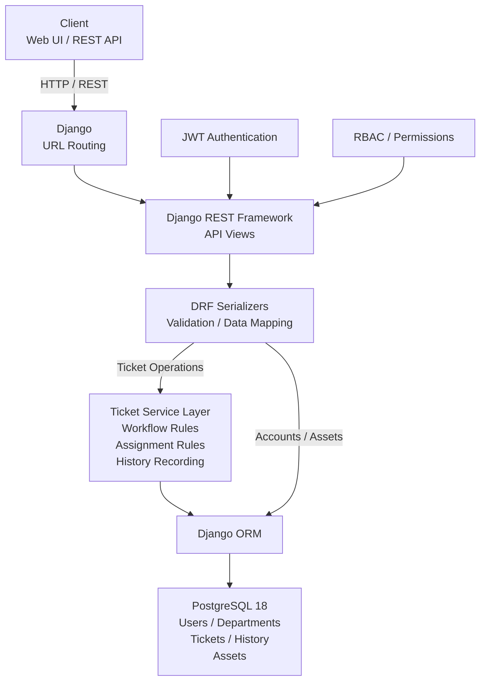
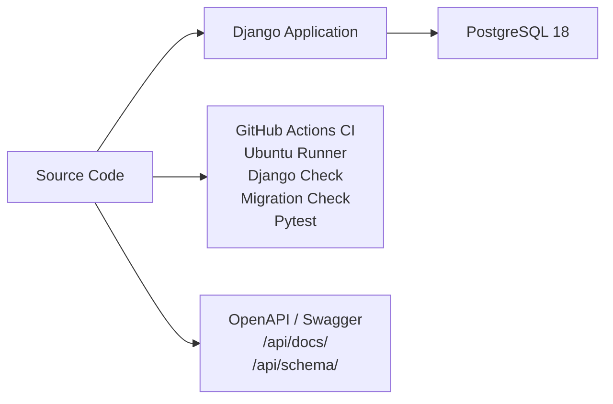

# System Architecture

## Overview

The Enterprise IT Service Desk Platform is built with Django and Django REST Framework using a layered backend architecture.

The system separates HTTP request handling, authentication and authorization, data validation, business rules, and database persistence.

PostgreSQL 18 is used as the primary relational database. GitHub Actions provides automated testing without Docker or Docker Compose.

## Architecture Diagram



## Engineering Infrastructure



## Application Layers

### API Layer

Django REST Framework API views handle incoming HTTP requests and API responses.

JWT authentication verifies the identity of API users, while role-based permissions control access according to the user's system role.

### Serialization and Validation Layer

DRF serializers handle request validation, data transformation, and API representation.

### Service Layer

Ticket business rules are separated from API views through the ticket service layer.

Responsibilities include:

- Ticket creation
- Ticket assignment and reassignment
- Ticket workflow validation
- Resolution rules
- Ticket history recording

The current service layer primarily handles ticket-domain business logic. Accounts and asset operations interact with the persistence layer through their respective Django and DRF components.

### Persistence Layer

Django ORM provides the persistence layer between the application and PostgreSQL 18.

The primary domain data includes:

- Users
- Departments
- Tickets
- Ticket history
- Assets

## Infrastructure

### Database

PostgreSQL 18 is the primary relational database.

The Django application connects to PostgreSQL through the Django PostgreSQL database backend and the psycopg driver.

Database connection settings are managed through environment variables:

- `DB_NAME`
- `DB_USER`
- `DB_PASSWORD`
- `DB_HOST`
- `DB_PORT`

The local development environment uses PostgreSQL on port `5432`.

### Continuous Integration

GitHub Actions automatically validates pushes and pull requests to the `main` branch.

The CI pipeline runs directly on an Ubuntu virtual machine and does not use Docker or Docker Compose.

The pipeline performs:

- Python 3.14 environment setup
- PostgreSQL 18 installation and service startup
- CI database role and database creation
- Python dependency installation
- Django system check
- Missing migration check
- Complete Pytest test suite

The CI database account has the `CREATEDB` privilege so pytest-django can create its isolated test database.

The current automated test suite contains 52 tests covering authentication, ticket APIs, RBAC, ticket workflow rules, ticket history, dashboard and report permissions, asset management, and system management behavior.

### API Documentation

OpenAPI documentation is generated with drf-spectacular.

Swagger UI is available at:

```text
/api/docs/
```

The OpenAPI schema is available at:

```text
/api/schema/
```
